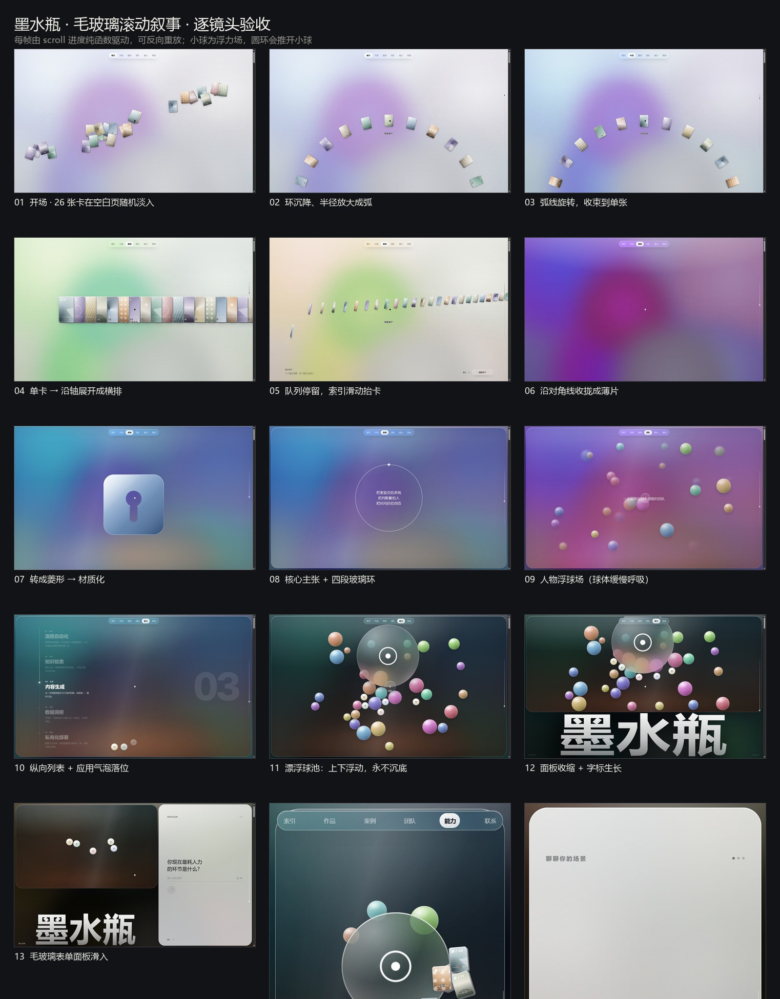

# 墨水瓶 · 滚动叙事官网

一条「固定舞台 + 滚动驱动」的叙事体验：整页只有一个全屏舞台，26 张图卡、玻璃面板、人物浮球在滚动中连续变形、重组、转场，没有翻页也没有硬切。所有动效都是滚动进度的纯函数，反向滚动会原路倒放。

视觉上是毛玻璃（backdrop blur + 高饱和）叠在一层缓慢漂移的色球壁纸上，所以玻璃有东西可折射。



## 目录

```
inkwell/          源码（三个文件，无构建依赖）
  index.html
  style.css
  app.js
  inter.woff2
docs/             发布产物（GitHub Pages 入口）
  index.html      单文件：CSS / JS / 字体全部内联，零外部请求
  .nojekyll
dist/             同 docs/index.html 的副本，方便拖到任意静态托管
tools/
  build.js        打包：inkwell/ → docs/ + dist/
  serve.js        本地预览服务
```

源码侧只依赖浏览器，没有框架、没有 npm 依赖、没有 CDN。`docs/index.html` 是一个 168KB 的自包含文件，双击即可打开。

## 本地预览

```bash
node tools/serve.js
# http://127.0.0.1:8080/
```

想看手机上的效果：

```bash
node tools/serve.js --host 0.0.0.0
# 然后用手机访问 http://<这台机器的内网 IP>:8080/
```

调试参数：`?s=0.86` 直接跳到球池那一镜，`?t=5.0` 冻结在开场第 5 秒。

## 打包

```bash
node tools/build.js
```

改完 `inkwell/` 里的源码后跑一次，`docs/index.html` 与 `dist/index.html` 会同步更新。

## 部署到 GitHub Pages

1. 在 GitHub 上新建一个 **Public** 仓库（Pages 的免费额度只对公开仓库开放）
2. 把本仓库推上去
3. 仓库 `Settings → Pages → Build and deployment`
   - Source: **Deploy from a branch**
   - Branch: `main`，目录选 **`/docs`**
   - Save
4. 等半分钟到一分钟，访问 `https://<用户名>.github.io/<仓库名>/`

或者用 GitHub CLI 一条命令搞定：

```bash
gh repo create <仓库名> --public --source=. --push
gh api -X POST repos/<用户名>/<仓库名>/pages -f 'source[branch]=main' -f 'source[path]=/docs'
```

站点本身是公开的，拿到链接的人都能看。如果只想给少数人看，别用 Pages，改用内网服务或临时隧道。

## 已知边界

- 末尾的表单是**纯前端演示**，回车只切换问答步骤，不会真的提交；接接收端需要另配接口。
- 中文回退到系统字体（PingFang SC / 微软雅黑 / 思源黑体），西文与数字使用内联的 Inter。
- 全站文案为占位草稿（能力列表、表单问题），需按实际业务替换。